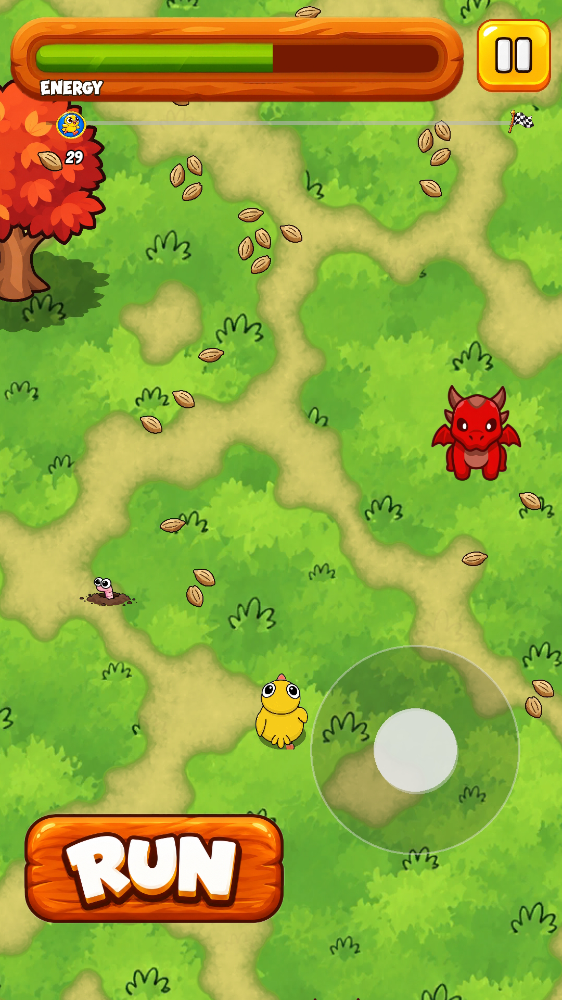
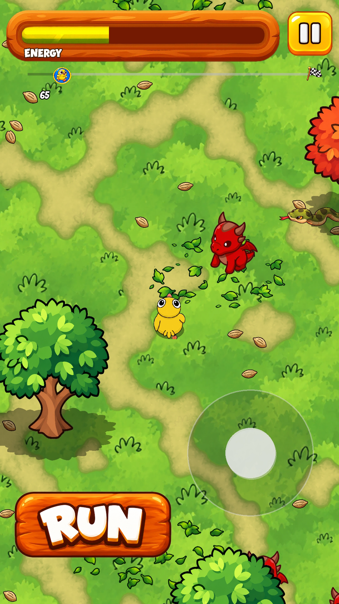
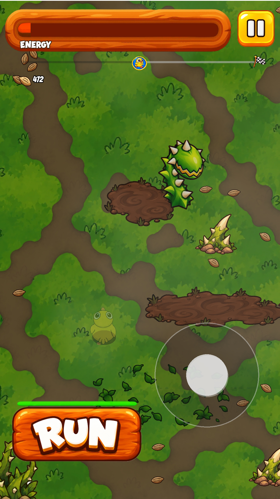
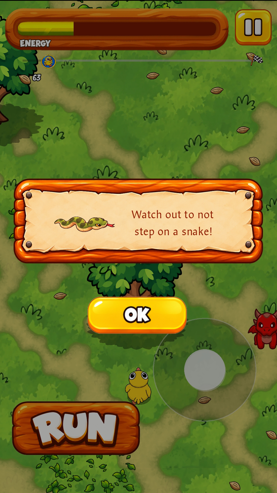
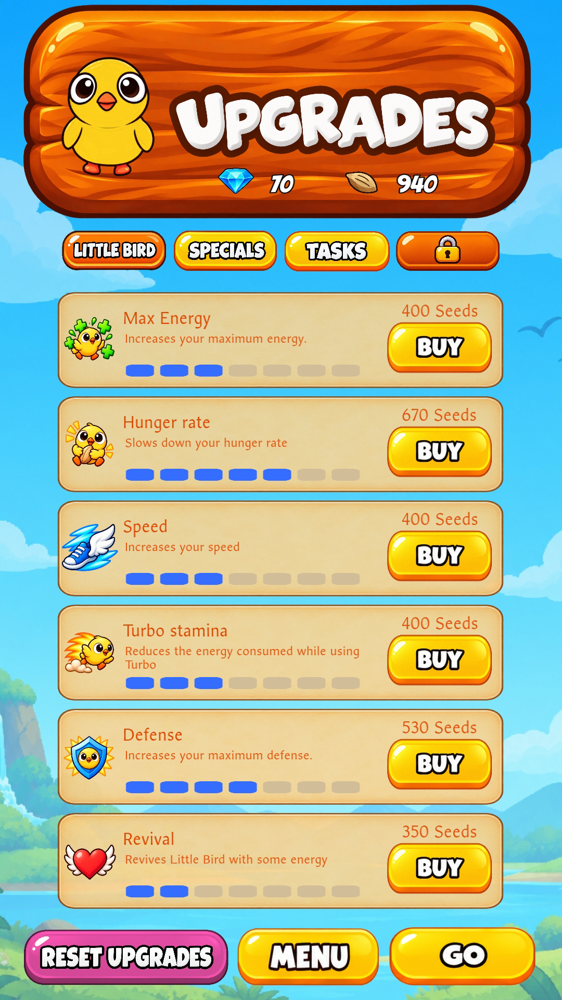
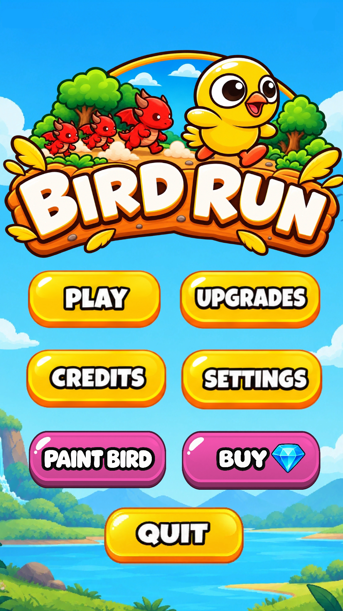

## Bird Run

Bird Run is an endless runner game developed using Godot Engine and GDScript.

Take control of a little bird, collect seeds, avoid obstacles and explore different environments as the difficulty increases.

## GAME OVERVIEW

The game features multiple environments, gameplay mechanics, collectible items and progression systems.

- Endless runner gameplay
- Multiple worlds and environments (Grasslands, Swamp, Volcano)
- Dynamic difficulty progression
- Seed collection system
- Upgrade and progression systems
- Various obstacles and environmental hazards
- Custom game UI and animations
- Sound effects and music integration

## DEVELOPED BY: 
Vinicius Gobatto

## GAMEPLAY SCREENSHOTS

  
  
  
  
  
  
  
  

## GAMEPLAY VIDEO

Check out Bird Run in action!

[Watch on YouTube](https://youtube.com/shorts/MvycpzVI39c)

